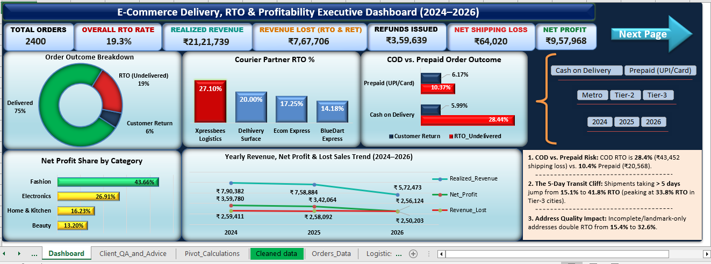
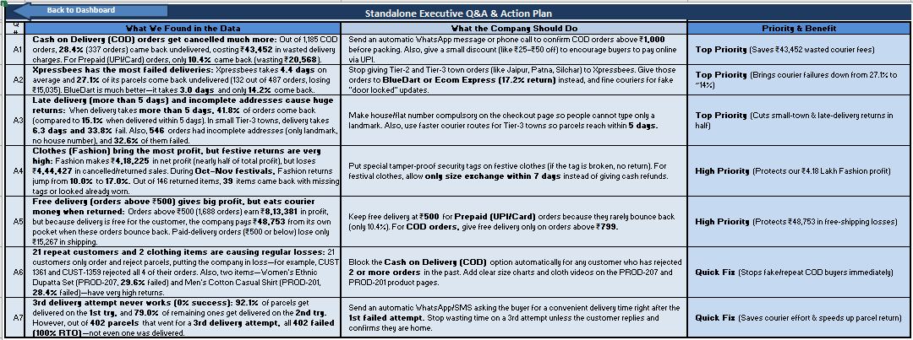
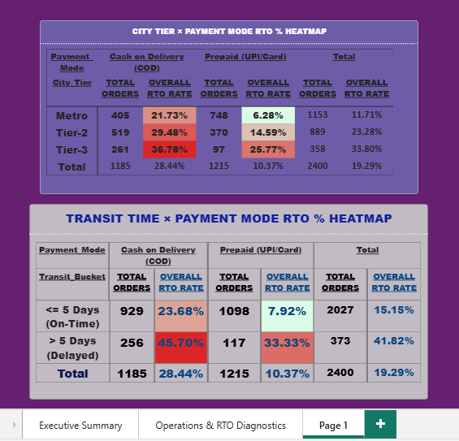

# E-Commerce Delivery, Return (RTO) & Profitability Analysis (Excel & Power BI)

## Project Overview
An end-to-end operational and financial analysis of **2,400 e-commerce orders (2024–2026)** across 6 relational tables (`Orders`, `Customers`, `Products`, `Shipping`, `Couriers`, and `Returns`). Built independently in both **Microsoft Excel** and **Power BI** with **100% metric reconciliation** across both tools.

## Key Reconciled Metrics
* **Total Orders Analyzed:** 2,400
* **Realized Revenue:** ₹21,21,739
* **Net Profit:** ₹9,57,968
* **Overall Return-to-Origin (RTO) Rate:** 19.29%
* **Net Shipping Loss from Returns:** ₹64,020
* **Lost Sales Value from Undelivered Orders:** ₹7,67,706

## Root-Cause & Cross-Tab Findings
1. **Payment Mode Impact (Independent of Delivery Speed):**
   * Overall Cash on Delivery (COD) RTO is **28.44%** (1,185 orders) vs. **10.37%** for Prepaid (1,215 orders).
   * Even among on-time deliveries (`<= 5 Days`), COD fails at **23.68%** (929 orders) vs. **7.92%** for Prepaid (1,098 orders), confirming COD carries higher return risk on its own.
2. **Transit Delay Multiplier:**
   * When delivery exceeds 5 days (`> 5 Days`), return rates jump to **45.70%** for COD (256 orders) and **33.33%** for Prepaid (117 orders).
3. **Regional & Address Quality Risks:**
   * Tier-3 COD orders experience a **36.78%** RTO rate (261 orders) compared to **25.77%** for Tier-3 Prepaid (97 orders).
   * Incomplete or landmark-only addresses double return rates from **15.37%** to **32.60%**.

## Dashboard Previews

## Tools & Techniques Used
* **Microsoft Excel:** Data cleaning, `VLOOKUP`, `SUMIFS`, `COUNTIFS`, Pivot Tables, KPI reconciliation.
* **Microsoft Power BI:** Star-schema data modeling, DAX measures (`CALCULATE`, `DIVIDE`), cross-tabulated matrix heatmaps, interactive slicers.
